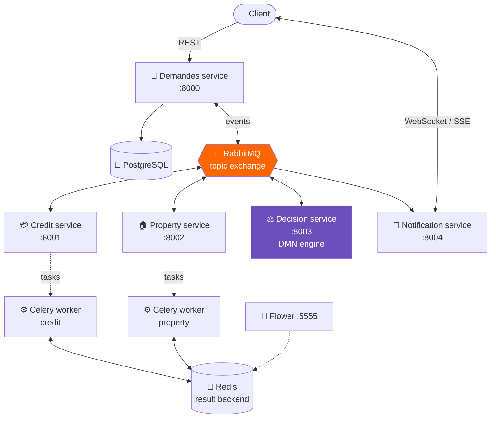
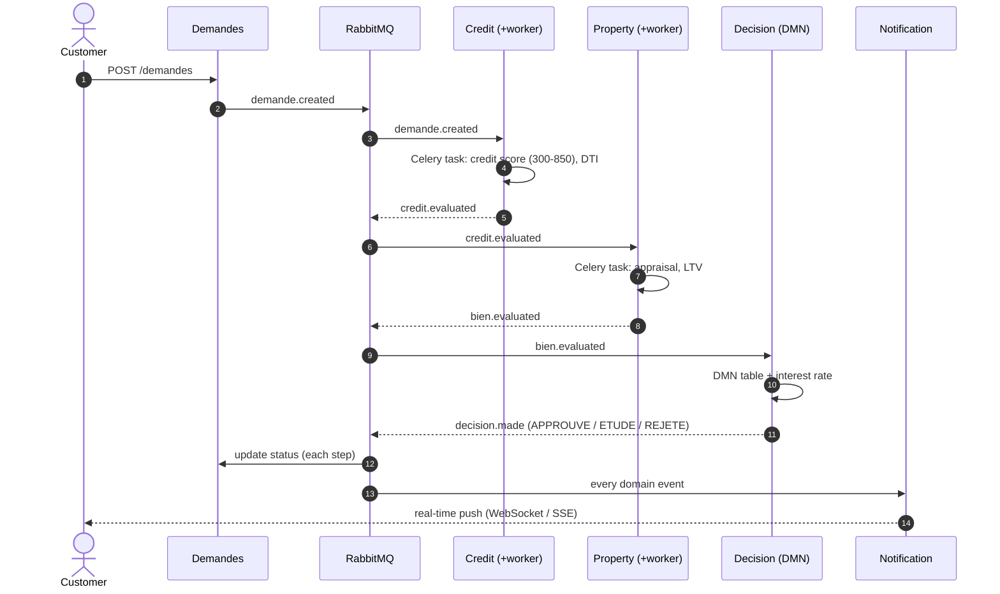
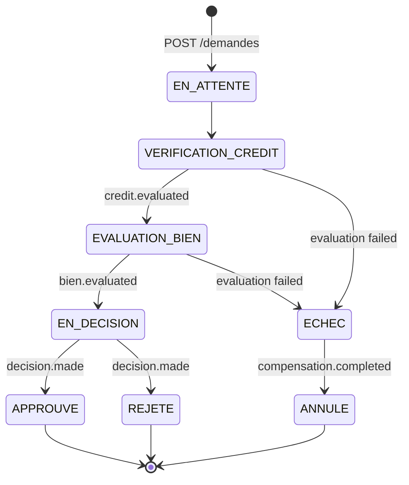
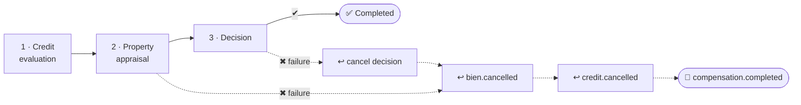
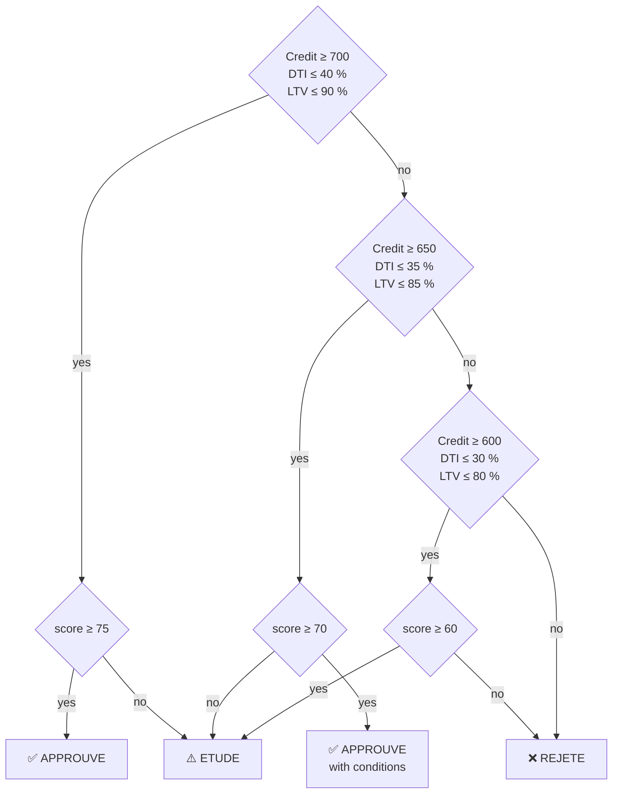

<div align="center">

# 🏦 Event-Driven Mortgage Approval Platform

**A distributed, fault-tolerant loan-evaluation system built on microservices, the Saga pattern and DMN decision rules.**

[](https://www.python.org/)
[](https://fastapi.tiangolo.com/)
[](https://www.rabbitmq.com/)
[](https://docs.celeryq.dev/)
[](https://www.postgresql.org/)
[](https://redis.io/)
[](https://docs.docker.com/compose/)

*Master's project — Business Process Management (TD3)*

</div>

---

## 📌 Table of contents

- [Overview](#-overview)
- [Architecture](#-architecture)
- [Business process](#-business-process)
- [Saga & compensation](#-saga--compensation)
- [DMN decision table](#-dmn-decision-table)
- [Services & API](#-services--api)
- [Quick start](#-quick-start)
- [Project structure](#-project-structure)

---

## 🎯 Overview

A customer submits a mortgage application; five independent services cooperate through **event choreography** on RabbitMQ — no central orchestrator — to assess the applicant's credit, appraise the property, apply a **DMN decision table**, and notify the customer **in real time** over WebSocket/SSE.

Distributed consistency is guaranteed by a **choreographed Saga** with business compensation: if any step fails, previously completed steps are undone automatically.

| | Guarantee | How |
|---|---|---|
| 🔀 | **Loose coupling** | Each service owns its data; communication only through domain events |
| ⚡ | **Async workers** | CPU/IO-heavy evaluations offloaded to horizontally scalable Celery workers |
| ♻️ | **Consistency** | Saga pattern (in-memory + persistent orchestrator) with compensations |
| 🛡️ | **Fault tolerance** | Manual ACK, retries, dead-letter queues, idempotent handlers |
| 📡 | **Real-time** | WebSocket & Server-Sent Events per application |
| 🔭 | **Observability** | RabbitMQ management UI, Flower dashboard, health endpoints |

---

## 🏗️ Architecture



---

## 🔄 Business process



### Application state machine



---

## ♻️ Saga & compensation

Each step registers an **execute** and a **compensate** action. On failure the orchestrator runs compensations in **reverse order**.



Event catalogue (`shared/events.py`):

`demande.created` · `demande.updated` · `credit.evaluation.requested` · `credit.evaluated` · `credit.evaluation.failed` · `bien.evaluation.requested` · `bien.evaluated` · `bien.evaluation.failed` · `decision.requested` · `decision.made` · `compensation.triggered` · `compensation.completed` · `credit.cancelled` · `bien.cancelled` · `notification.sent`

---

## ⚖️ DMN decision table

A weighted score (0–100) is computed from four criteria, then a decision table is applied:

| Criterion | Max points | Best band |
|---|:---:|---|
| Credit score | 35 | ≥ 750 |
| Income / amount ratio | 25 | ≥ 5× |
| Debt-to-income (DTI) | 20 | ≤ 25 % |
| Loan-to-value (LTV) | 20 | ≤ 70 % |



The interest rate is then derived from the risk profile (credit score × LTV).

---

## 🔌 Services & API

| Service | Port | Key endpoints |
|---|:---:|---|
| **Demandes** | 8000 | `POST /demandes` · `GET /demandes` · `GET /demandes/{id}` · `PUT /demandes/{id}/statut` · `DELETE /demandes/{id}` |
| **Credit** | 8001 | `POST /credit/evaluer` · `GET /credit/task/{task_id}` |
| **Property** | 8002 | `POST /bien/evaluer` · `GET /bien/task/{task_id}` |
| **Decision** | 8003 | `POST /decision/evaluer` · `GET /decision/regles` |
| **Notification** | 8004 | `WS /ws/{demande_id}` · `GET /sse/{demande_id}` · `POST /notifications/send` |
| RabbitMQ UI | 15672 | management console |
| Flower | 5555 | Celery monitoring |

Every service exposes `GET /health` and interactive docs at `/docs` (Swagger).

---

## 🚀 Quick start

```bash
git clone https://github.com/mohamedabi17/Implmentation-d-un-Processus-d-evaluation-de-Demandes.git
cd Implmentation-d-un-Processus-d-evaluation-de-Demandes

./start.sh            # docker compose up --build -d  (RabbitMQ, Redis, Postgres, 5 services, 2 workers, Flower)
```

Submit an application:

```bash
curl -X POST http://localhost:8000/demandes \
  -H "Content-Type: application/json" \
  -d '{"client_id":"C-001","montant_demande":200000,"revenu_annuel":65000,"duree_pret_mois":240,"adresse_bien":"12 rue de la Paix, Paris"}'
```

Follow it live:

```bash
websocat ws://localhost:8004/ws/<demande_id>
```

Stop everything with `./stop.sh`.

---

## 📁 Project structure

```
.
├── services/
│   ├── demandes/          # API gateway of the process, PostgreSQL repository, event consumer
│   ├── credit/            # FastAPI + Celery tasks (credit scoring)
│   ├── evaluation_bien/   # FastAPI + Celery tasks (property appraisal, LTV)
│   ├── decision/          # DMN rules engine, interest-rate computation
│   └── notification/      # WebSocket / SSE / e-mail simulation
├── shared/
│   ├── events.py          # Typed domain events (Pydantic)
│   ├── rabbitmq.py        # Async publisher / consumer (aio-pika)
│   ├── saga.py            # Saga orchestrator + compensation
│   └── saga_persistent.py # Saga state persisted for crash recovery
├── docker-compose.yml
├── start.sh / stop.sh
└── rapport.tex            # Full technical report
```

---

<div align="center">

**Mohamed Abi** · [GitHub @mohamedabi17](https://github.com/mohamedabi17)

</div>
